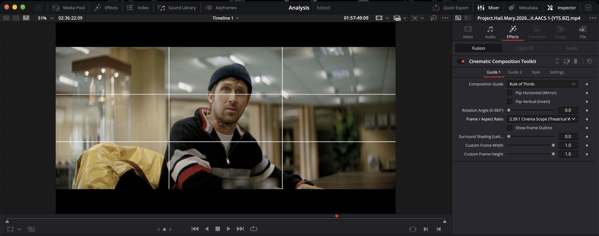

# Cinematic Composition Toolkit for DaVinci Resolve

Cinematic Composition Toolkit lets you analyze, compose, and study cinema frames in DaVinci Resolve without repetitive manual grid setup or low-resolution static overlays.

Packaged as a lightweight `.drfx` plugin (under 13 KB) built with a single-pass procedural vector engine in Fusion. Zero external image dependencies, zero missing media errors, and real-time 60+ FPS hardware acceleration across all timeline resolutions.

<!-- SCREENSHOT PLACEHOLDER: HERO OVERVIEW -->
<!-- Recommended size: 1920x1080 or 1280x720 PNG showing the overlay active over a film frame -->


---

## The Story Behind the Toolkit

It started late at night in an editing suite, with the timeline paused on a single frame.

I was watching visual breakdowns of Roger Deakins' cinematography in *Blade Runner 2049* and Greig Fraser's expansive desert compositions in *Dune*. Every twenty seconds, I found myself pausing the playback, leaning forward toward the glass, and physically tracing the lines of the frame with my finger.

I wanted to understand the craft at a deeper level. Why does an actor positioned in the lower corner of an empty room feel completely suffocated by loneliness, while placing them two inches higher turns the exact same shot into a portrait of quiet dignity? What geometric choices did the director of photography make, and what rules were they intentionally bending?

I opened DaVinci Resolve to study these frames systematically. **But** Resolve's native tools were never built for compositional study. 

Every time I wanted a simple composition grid, I had to drag the generic grid generator onto a clip, manually change the horizontal lines to 3, change the vertical lines to 3, adjust the line thickness, and change the line color. When I moved to the next shot, I had to repeat the entire sequence from scratch because Resolve does not support saving quick grid presets like Premiere Pro.

Worse still, classical compositional aids did not exist at all. There was no Golden Ratio. No Fibonacci spiral. No harmonic armature. No dialogue headroom or eyeline guides. And no way to preview a 2.39:1 scope crop inside a 1.43:1 IMAX frame without building complex compound clips.

The only alternative was downloading low-resolution PNG graphics from the web. **But** static image files brought their own headaches: they stretched and distorted when switching aspect ratios, obscured the footage underneath, and frequently threw missing media errors when moving projects between machines.

**Therefore**, I decided to build a native vector overlay directly inside Fusion.

What began as a personal scratch tool to eliminate repetitive manual adjustments grew into something much bigger. I realized that if I felt this friction every night, other cinematographers, editors, film students, and visual storytellers were hitting the exact same wall.

The result is the **Cinematic Composition Toolkit**: a mathematically calibrated, dual-channel composition engine designed to help professionals and students deconstruct, compose, and master cinematic frames with zero wasted effort.

---

## Visual Walkthrough & Inspector Controls

<!-- SCREENSHOT PLACEHOLDER: RESOLVE INSPECTOR CONTROLS -->
<!-- Recommended screenshot: DaVinci Resolve Inspector showing the Guide 1, Guide 2, and Style tabs -->


The toolkit integrates natively into the DaVinci Resolve Inspector under three organized tabs:

* **Guide 1**: Primary composition overlay, aspect ratio preset, 1-click horizontal/vertical mirroring, 360-degree free rotation, frame boundary outline, viewfinder letterbox shading, and live custom dimensions.
* **Guide 2**: Simultaneous secondary channel for cross-format extraction (e.g. previewing a 9:16 mobile crop or 16:9 streaming delivery while composing for 2.39:1 theatrical widescreen) with independent color, opacity, rotation, and framing.
* **Style**: Primary line color picker, master opacity, and line thickness adjustments.

---

## Dual Guide Cross-Format Framing Engine

<!-- SCREENSHOT PLACEHOLDER: DUAL GUIDE CROSS-FORMAT -->
<!-- Recommended screenshot: A 2.39:1 Scope primary guide with a 9:16 or 16:9 secondary guide active over footage -->


High-end theatrical releases and commercial campaigns routinely deliver across multiple conflicting aspect ratios simultaneously. A shot composed for a 2.39:1 theatrical screen must also protect for a 16:9 television broadcast and extract cleanly into a 9:16 vertical crop for social channels.

With dual guide channels active at the same time:
* **Primary Channel (Guide 1)**: Defines your master theatrical canvas (e.g. 2.39:1 Cinema Scope).
* **Secondary Channel (Guide 2)**: Overlays your delivery constraint (e.g. 9:16 Vertical or 16:9 Safe Area) in a contrasting color.
* **Outcome**: You verify that key actors' eyes, facial expressions, and narrative action remain safely composed across all delivery formats without bouncing between timelines or guessing crop boundaries.

---

## Comprehensive 14-Guide Composition Library

<!-- SCREENSHOT PLACEHOLDER: COMPOSITION STUDY -->
<!-- Recommended screenshot: Fibonacci Spiral or Harmonic Armature overlaid across an iconic film still -->


Arranged logically from foundational camera coverage to classical geometry:

1. **Rule of Thirds**: Foundational cinema 3x3 grid for horizon placement, subject positioning, and power-point intersections.
2. **Headroom & Eyeline (Dialogue Framing)**: Built for conversation coverage—upper-third eyeline, 10–15% headroom boundary, center plumb line, and over-the-shoulder eye target crosshairs.
3. **Looking Room (Lead Room & Eyeline)**: Action and dialogue sightline balance—subject vertical axis, eye horizon, leading eye anchor reticle, center balance indicator, and lead room front boundary.
4. **Center Reticle (ARRI Optical Crosshairs)**: Viewfinder-style optical reticle with a center clearance opening that keeps fine focal details and pupils unobstructed, paired with a central alignment dot.
5. **Quadrant Grid (2x2 Symmetrical Quadrants)**: 4-quadrant division for multi-subject blocking, symmetrical compositions, and split-field diopter setups.
6. **Negative Space (Character Isolation)**: Solitary character isolation framing—ground horizon line, 1/9 corner subject cell, and vast 8/9 environmental negative space guide.
7. **Phi Grid (Golden Ratio Grid - 1:1.618:1)**: Classical golden section grid dividing the frame at 0.382 and 0.618 for softer, organic compositional balance.
8. **Golden Ratio (Spiral + Fibonacci Boxes)**: The complete textbook overlay combining a continuous logarithmic spiral, harmonic subdivision squares, and the asymptotic Golden Eye focal reticle.
9. **Golden Spiral (Fibonacci Spiral Only)**: Clean 249-point continuous logarithmic curve for camera movements, architecture, leading curves, and natural gaze flow.
10. **Golden Section (Fibonacci Boxes Only)**: Geometric subdivision structure displaying the harmonic squares behind the golden ratio.
11. **Golden Triangles (Dynamic Symmetry)**: Corner-to-corner diagonal with two perpendicular reciprocal rays intersecting at exact 90-degree right angles for dynamic diagonal balance.
12. **Harmonic Armature (14-Line Classical)**: Complete 14-line Renaissance master painter armature combining primary diagonals, center cross, and 8 midpoint reciprocals.
13. **Safe Areas (93% Action / 90% Title / 80% Text)**: Three-tier SMPTE ST 2046-1, SMPTE RP 27.3, and Netflix/EBU broadcast safe framing zones.
14. **None (Frame Outline Only)**: Clean aspect ratio framing box with no interior grid lines.

---

## 16 Precision Cinema Aspect Ratio Presets

1. **Full Frame (Match Timeline)** (Analyze source footage without cropping)
2. **2.39:1 Cinema Scope (Theatrical Widescreen)** (Theatrical anamorphic widescreen standard)
3. **2.00:1 Univisium (18:9 / Streaming Widescreen)** (Vittorio Storaro / Netflix / HBO standard)
4. **1.90:1 Digital IMAX** (Digital IMAX commercial theatrical release format)
5. **1.85:1 Flat Cinema (Standard Theatrical)** (Standard Hollywood theatrical flat)
6. **1.66:1 European Flat (Kubrick / A24)** (European cinema / indie favorite)
7. **1.43:1 IMAX GT Laser (70mm Full Height)** (Full-height 70mm IMAX format)
8. **1.33:1 (4:3 Classic Academy)** (Vintage Academy / Wes Anderson format)
9. **9:16 Vertical (Reels / TikTok / Shorts)** (Mobile video delivery preview)
10. **1:1 Square (Social / Art House)** (Square composition format)
11. **1.618:1 Golden Rectangle (Phi Dynamic)** (Classical golden rectangle format)
12. **2.236:1 Root 5 Dynamic Symmetry** (Root 5 Hambidge dynamic symmetry rectangle)
13. **1.732:1 Root 3 Dynamic Symmetry** (Root 3 Hambidge dynamic symmetry rectangle)
14. **1.414:1 Root 2 Dynamic Symmetry** (Root 2 dynamic symmetry rectangle)
15. **2.35:1 Scope (Vintage Panavision Pre-1970)** (Classic vintage scope format)
16. **Custom (Adjust Sliders Below)** (Custom framing with live width and height sliders)

---

## Technical Features

### ARRI & SmallHD Viewfinder Surround Shading
* **Surround Shading Slider (0.0 to 1.0)**: Smoothly dim inactive letterbox areas outside the active aspect ratio frame from 0% (fully transparent) to 50% (translucent monitor guide) to 100% (theatrical matte preview).
* **Safe DAG Architecture**: Placed downstream of the video merge to prevent circular buffer evaluation and guarantee 100% video passthrough.

### Continuous 360° Free Rotation & 4-Corner Flipping
* **Continuous Angle Rotation (0° to 360°)**: Rotate the Golden Spiral, diagonals, or armatures to align with Dutch angles, curving staircases, or architectural diagonals.
* **Flip Horizontal / Flip Vertical**: Instantly mirror directional guides into any of the 4 screen corners to match actor sightlines.

### Zero-Overhead Vector Pipeline
* Generated entirely from vector polyline mathematics inside Fusion.
* The entire plugin binary is under 13 KB.
* Delivers 60+ FPS real-time playback on standard hardware with zero cached render files.

---

## Installation

### Method 1: Automatic Script (macOS)
From the repository root, run:
```sh
sh tools/install_mac.sh
```

### Method 2: Double-Click Install (macOS & Windows)
1. Ensure DaVinci Resolve is running.
2. In your file browser, navigate to the `dist/` directory.
3. Double-click `Cinematic_Composition_Toolkit.drfx`.
4. Click **Install** when prompted by DaVinci Resolve.
5. Restart DaVinci Resolve.

---

## How to Use

1. Open your project in DaVinci Resolve and navigate to the **Edit** page.
2. In the **Effects Library**, open **Effects** -> **Cinematic Guides**.
3. Drag **Cinematic Composition Toolkit** onto:
   - An **Adjustment Clip** on a track above your edit (recommended for scene-wide study), or
   - Directly onto any individual clip on your timeline.
4. Open the **Inspector** -> **Effects** tab to select guides, aspect ratios, colors, and letterbox shading.

---

## Transparent Note on Perspective & Leading Lines

A personal note from the creator:

One request frequently raised by cinematographers and film analysts is an automated tool for perspective leading lines—lines that dynamically trace convergence points and vanishing lines along roads, hallways, or architecture.

At present, this toolkit does not include an automated vanishing point solver. Vector perspective tracking requires multi-point projective geometry that cannot yet be implemented cleanly in a lightweight, single-click Fusion macro without introducing performance drag or cluttered on-screen control handles. 

I am actively researching approaches for future versions to solve this cleanly. In the meantime, the 360-degree rotation and Golden Triangles / Harmonic Armature can be freely angled to analyze perspective diagonals accurately.

---

## Uninstallation

To remove the toolkit, run:
```sh
sh tools/uninstall_mac.sh
```
Or delete `Cinematic_Composition_Toolkit.drfx` from:
`~/Library/Application Support/Blackmagic Design/DaVinci Resolve/Fusion/Templates/`
